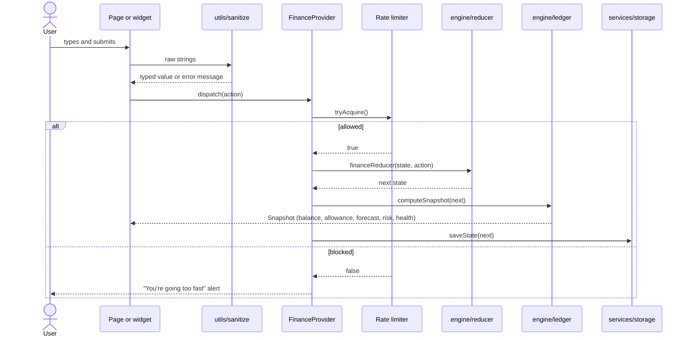
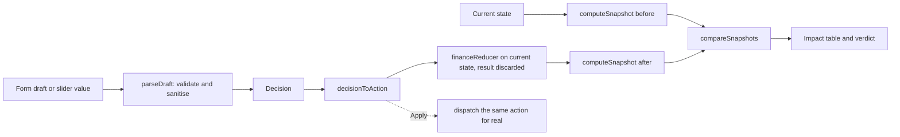

# Architecture


The diagram was drawn before the folders were renamed. Its "State (`src/state`)" band is now `src/context` and `src/hooks`; its "Domain (`src/domain`)" band is now `src/engine`, `src/utils` and `src/services`. The flow is unchanged.

## Layers

| Layer      | Folder            | May import from           | Responsibility                                                           |
| ---------- | ----------------- | ------------------------- | ------------------------------------------------------------------------ |
| Types      | `src/types/`      | Nothing                   | The data model                                                           |
| Constants  | `src/constants/`  | Types                     | Limits, labels, routes, presets                                          |
| Utilities  | `src/utils/`      | Types, constants          | Formatting, sanitising, ids, rate limiting, class names                  |
| Engine     | `src/engine/`     | Types, constants, utils   | State transitions and every calculation. Pure: no React, no DOM          |
| Services   | `src/services/`   | Types, constants, utils   | The browser edge: storage, preferences, service worker, web vitals       |
| Context    | `src/context/`    | Engine, services          | Holds the ledger and theme, memoises the snapshot, rate-limits, persists |
| Hooks      | `src/hooks/`      | Context, constants        | Reusable behaviour: routing, media queries, theme, animated numbers      |
| Components | `src/components/` | Everything above          | `ui/` primitives, `layout/` shell, `charts/`, and feature widgets        |
| Pages      | `src/pages/`      | Components, hooks, engine | One per route; composes widgets. Lazy-loaded except the dashboard        |
| Styles     | `src/styles/`     | —                         | Tokens, base, components, shell, widgets, motion                         |

Dependencies point inward only. The engine does not know React exists, and primitives in `components/ui/` do not know about finance state.

## Data model

```ts
FinanceState {
  version: 1
  currentDay: number              // 1–30
  transactions: Transaction[]     // expense | income | saving
  scheduled: ScheduledPayment[]   // commitment | subscription
  goals: Goal[]
}
```

Deliberately not stored: balance, allowance, forecast, risk, health, goal totals, the month map and achievements. They are derived on demand, so they cannot go stale.

Goal contributions are `saving` transactions that reference a goal. This gives one ledger for the activity feed, the balance and goal progress.

## Data flow



## Simulation



The preview and the real change share `decisionToAction` and `financeReducer`. A test asserts that applying a decision produces the simulated balance. The dashboard's impulse check and smart moves call the same `simulate` function.

## Routing and code splitting

`useHashRoute` maps the URL hash (`#/simulate`) to a view with `useSyncExternalStore`. Each view therefore has a link, the back button works, and no server rewrite rules are needed on any static host.

`App.tsx` imports the dashboard eagerly, because it is the first paint, and loads the other three pages with `React.lazy` behind `Suspense`. `usePrefetch` downloads those chunks when the browser is idle. `vite.config.ts` uses `manualChunks` to keep React, icons and `web-vitals` in their own long-lived files.

## Theming

Tokens in `styles/tokens.css` are redefined under `[data-theme='dark']` and under `prefers-color-scheme: dark` for the moment before JavaScript runs. `ThemeProvider` follows the system until the user chooses, then stores the choice.

## Key decisions

| Decision                                                          | Reason                                                                             | Trade-off                                            |
| ----------------------------------------------------------------- | ---------------------------------------------------------------------------------- | ---------------------------------------------------- |
| No backend                                                        | A single-user simulation gains nothing from a server; one would add attack surface | No sync between devices                              |
| `useReducer` + context instead of a state library                 | One small state object, one consumer tree                                          | Consumers re-render on change; mitigated with `memo` |
| Derived snapshot instead of stored totals                         | Removes a whole class of inconsistency bugs                                        | Recomputed on each change (negligible)               |
| Hash routing without a router library                             | Deep links on any static host for about 30 lines of code                           | URLs contain `#/`                                    |
| Tailwind for layout, design-system CSS for components             | Responsive utilities in the markup; rich textures and motion stay readable in CSS  | Two places to look for styles                        |
| One navigation element repositioned by CSS                        | No duplicated tabs for assistive technology                                        | The shell CSS carries the breakpoint logic           |
| Hand-written SVG charts                                           | Avoids a chart library many times the size of the app                              | Fewer chart features                                 |
| CSS animations plus one small hook                                | Keeps first-load JavaScript small and the CSP strict                               | No physics-based springs                             |
| Hand-written service worker                                       | No plugin dependency; network-first pages can never serve a stale deploy           | No precache manifest                                 |
| Whole rupees                                                      | Avoids floating-point money errors                                                 | No paise                                             |
| Scheduled payments charged by derivation (`dueDay <= currentDay`) | The calendar can be moved without replaying events                                 | Cancelling stores a day, not an event log            |
| Clock and randomness injected                                     | Deterministic tests                                                                | Slightly more parameters                             |

## Error handling

- **Invalid input:** rejected by `utils/sanitize` with a message shown next to the field.
- **Invalid actions:** the reducer returns the same state (for example, saving to a missing goal).
- **Corrupt storage:** `parseState` drops bad entries or returns `null`, and the app falls back to the demo month.
- **Storage unavailable:** `saveState` returns `false`; the app keeps working in memory.
- **Rendering fault:** `ErrorBoundary` shows a reload prompt.
- **Offline:** the service worker serves the cached shell; a notice confirms data is still saved locally.

## Build and delivery

Vite produces hashed static assets. Two build-only plugins in `vite.config.ts` add the Content Security Policy meta tag and a preload for the UI font. `vercel.json` and `public/_headers` supply HTTP security headers and long-lived caching for hashed assets. CI runs audit, typecheck, lint, format check, tests and build.
