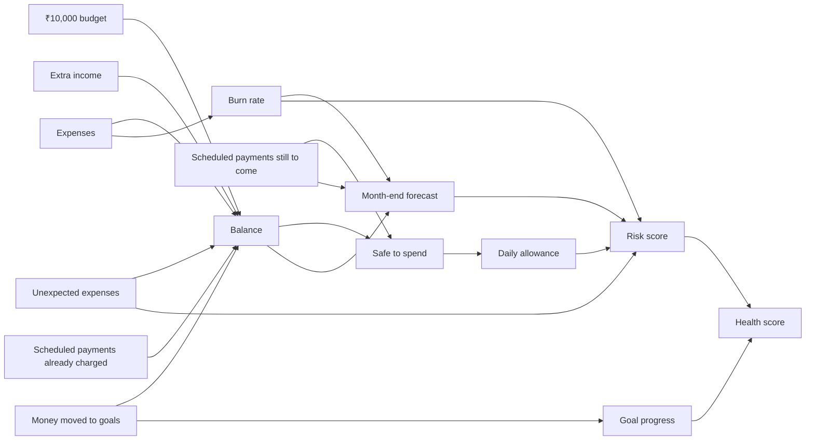
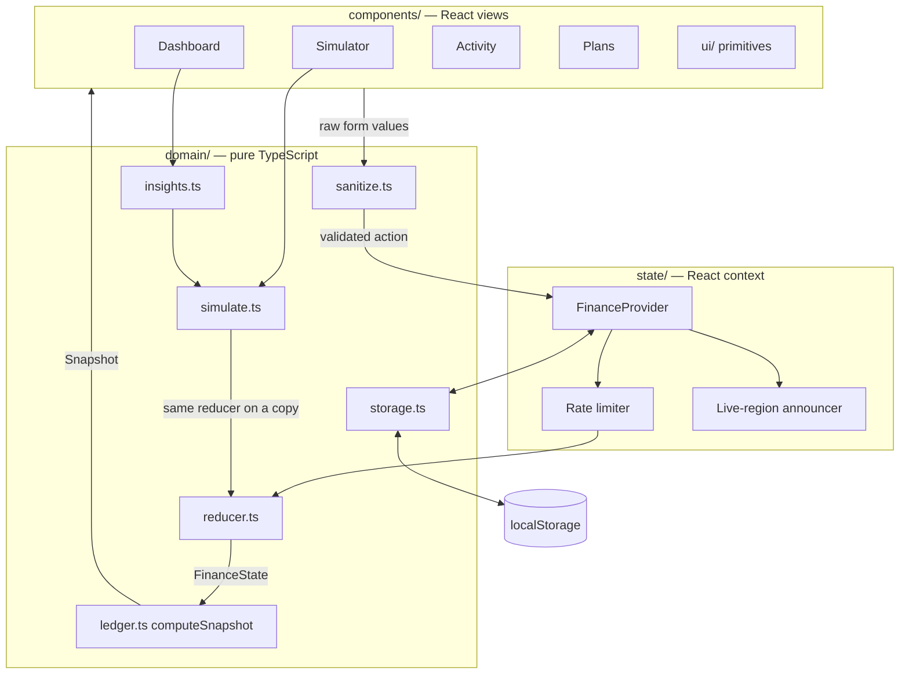

# Broke But Functional

**₹10,000. 30 days. See the consequences before you spend.**

A personal finance experience for Gen Z that goes beyond expense tracking. Income, balance, spending, commitments, subscriptions, savings goals, unexpected expenses, risk and financial health are all derived from one ledger, so every decision visibly moves everything else. Any decision can be simulated first.

| | |
| --- | --- |
| **Stack** | React 19 · TypeScript (strict) · Vite 8 · Vitest · Testing Library · axe-core · ESLint |
| **Runtime dependencies** | `react`, `react-dom`, three self-hosted font packages. No UI, chart, state or animation library |
| **Tests** | 166 tests in 12 files, about 98% statement coverage |
| **Lighthouse (mobile, production build)** | Performance 98 · Accessibility 100 · Best Practices 100 · SEO 100 · CLS 0 · TBT 0 ms |
| **Backend** | None. Static files; data stays in the browser |

## Contents

1. [Quick start](#quick-start)
2. [Features mapped to the problem statement](#features-mapped-to-the-problem-statement)
3. [How the numbers connect](#how-the-numbers-connect)
4. [Architecture](#architecture)
5. [Evaluation parameters: where each is addressed](#evaluation-parameters-where-each-is-addressed)
6. [Design system and motion](#design-system-and-motion)
7. [Scripts](#scripts)
8. [Documentation](#documentation)
9. [Known limits](#known-limits)

## Quick start

```bash
npm install
npm run dev        # http://localhost:5173
npm run check      # typecheck + lint + tests + production build
npm run preview    # serve the production build on http://localhost:4173
```

Requires Node 20 or newer. The app opens on a demo month (day 6, sample data). "Start a fresh month" on the Overview resets to a clean ₹10,000.

## Features mapped to the problem statement

| Requirement | Where it lives |
| --- | --- |
| Manage a limited ₹10,000 budget over 30 days | **Overview**: balance, "safe to spend today", day stepper that moves the calendar |
| Income, spending, unexpected expenses | **Activity**: log expenses, income and one-off shocks; spending by category |
| Commitments and subscriptions | **Plans**: scheduled payments are reserved before the allowance is calculated and charged on their due day; subscriptions can be cancelled and resumed |
| Savings goals | **Plans**: money moved to a goal leaves the spendable balance; removing a goal returns it |
| Simulate decisions before taking them | **What if?**: preview a purchase, new subscription, cancellation, goal transfer, extra income or surprise expense. Nothing changes until "Apply" |
| Effect on balance, daily allowance, goals, forecast, risk, health | The impact table shows all six before and after, with a verdict: Go for it / Think twice / Not a good idea |
| Monthly forecast | **Overview**: actual vs projected balance chart, and the day money runs out |
| Financial risk and health | **Overview**: 0–100 risk score with plain-language reasons; 0–100 health gauge with a grade |
| Unexpected expenses | "Throw me a curveball" draws a surprise expense into the simulator |
| Interconnected, visible consequences | **Smart moves**: suggestions computed by the simulator, quoting the real effect of each move |

## How the numbers connect



- **Balance** = ₹10,000 + extra income − expenses − money moved to goals − scheduled payments already charged
- **Safe to spend** = balance − scheduled payments still to come
- **Daily allowance** = safe to spend ÷ days left (including today)
- **Burn rate** = everyday spending ÷ days elapsed. Unexpected expenses are excluded so one shock does not distort the pace
- **Forecast** = today's balance, minus the burn rate each remaining day, minus each scheduled payment on its due day
- **Risk (0–100)** = spending pace vs allowance (up to 35) + running out or a thin month-end cushion (up to 40) + balance not covering promised payments (20) + unfunded goals (10) + shock exposure (up to 5)
- **Health (0–100)** = 90% from low risk + 10% from savings-goal progress

## Architecture


The numbered arrows follow one user action end to end. Solid arrows are real state changes; dashed arrows are the simulator working on a copy. Note that `storage.ts` is drawn in the browser-platform band for layout reasons but lives in `src/domain/`. The same structure as a text diagram:



Three rules keep it clean:

1. **One source of truth.** `FinanceState` is the only stored data. Everything on screen is derived from it by `computeSnapshot`, so views cannot disagree.
2. **The domain layer is pure.** `src/domain/` has no React, no DOM beyond storage, and no hidden clocks or randomness (both are injectable). It is tested without rendering anything.
3. **The simulator reuses the real reducer.** A preview runs the same action on a copy of the state, so it can never differ from what applying the decision does.

```
src/
  domain/        types, constants, ledger, reducer, simulate, insights,
                 sanitize, storage, rateLimit, seed, curveballs, format, id
  state/         FinanceProvider, finance-context, useFinance
  hooks/         useAnimatedNumber
  components/
    dashboard/   Dashboard, DayControl, ForecastChart, HealthGauge
    simulator/   Simulator, ImpactTable, draft (form → decision)
    activity/    Activity
    plans/       Plans, GoalsPanel, ScheduledPanel
    ui/          Field, Tabs, Badge, ProgressBar, ConfirmButton,
                 AnimatedNumber, PanelSkeleton, BrandMark
  styles/        tokens, base, components, motion
  test/          setup and shared test helpers
```

More detail: [docs/ARCHITECTURE.md](docs/ARCHITECTURE.md).

## Evaluation parameters: where each is addressed

### 1. Code quality and clean architecture

- Strict TypeScript, including `noUncheckedIndexedAccess`; no `any` (lint-enforced).
- Layered: pure domain → context → views → primitives. Dependencies only point inward.
- Discriminated unions for actions and decisions; the reducer and decision mapper are exhaustively typed.
- Named constants for every limit; no magic numbers in components.
- ESLint with `typescript-eslint`, `react-hooks` and `jsx-a11y`; zero warnings.

### 2. Security and data sanitisation

- Free text is normalised and stripped of markup delimiters, control, zero-width and bidi-override characters, then length-capped.
- Amounts and days are parsed with strict whole-number patterns and ranges.
- Stored data is untrusted: re-validated field by field, rebuilt into fresh objects, oversized payloads refused.
- Sliding-window rate limiter on every state change; hard caps on every collection.
- Strict Content Security Policy with no `unsafe-inline` and no `unsafe-eval`; security headers for Vercel and Netlify.
- No `dangerouslySetInnerHTML`, no `eval`, no inline styles, no third-party requests.

Full threat model, including why SQL injection and server-side DDoS protection do not apply to a static app: [SECURITY.md](SECURITY.md).

### 3. Runtime efficiency and Core Web Vitals

Measured with Lighthouse (mobile emulation, simulated throttling) against `npm run preview`, which serves uncompressed files:

| Metric | Result |
| --- | --- |
| Performance score | 98 |
| Largest Contentful Paint | 2.1 s |
| First Contentful Paint | 1.8 s |
| Total Blocking Time | 0 ms |
| Cumulative Layout Shift | 0 |

- About 79 kB gzipped JavaScript on first load; Simulator, Activity and Plans are lazy chunks.
- A static shell in `index.html` paints before JavaScript runs.
- The UI font is preloaded; all fonts are self-hosted with `font-display: swap`.
- Animations use transform, opacity and paint-only properties, so layout never shifts.
- The snapshot is memoised on state; the chart and gauge are `memo`ised.

### 4. Component testing and reliability

- 166 tests: domain engine, reducer, simulator, insights, sanitiser, storage, rate limiter, every UI primitive, and each view through real user interactions.
- Covers keyboard navigation, validation, hostile input, corrupt and oversized storage, prototype pollution, persistence across reloads, rate limiting and animation timing.
- An error boundary keeps a rendering fault from blanking the app.
- Storage failures (private mode, quota) fail soft.

Strategy and how to run: [docs/TESTING.md](docs/TESTING.md).

### 5. Accessibility

- Lighthouse accessibility 100; axe-core runs against every view in the test suite.
- Skip link, landmarks, one `h1`, ordered headings.
- WAI-ARIA tabs with roving tabindex (arrow keys, Home, End) and a focusable tab panel.
- Every input has a visible label; errors are linked with `aria-describedby` and `aria-invalid`.
- Changes are announced through a polite live region; blocked actions through an alert.
- Charts have text alternatives; status never relies on colour alone; 44 px targets; visible focus rings; forced-colours support; all motion off under `prefers-reduced-motion`.

Details: [docs/ACCESSIBILITY.md](docs/ACCESSIBILITY.md).

### 6. Technical specification alignment

Every clause of the problem statement is traced to a feature and a test in [docs/SRS.md](docs/SRS.md).

## Design system and motion

**Pocket Ledger**: a paper-notebook look. Cream pages, navy ink, one ballpoint-blue accent, a marigold highlighter, a coral margin line, ruled and dot-grid textures. Instrument Serif for headings, Figtree for UI and figures, Kalam for handwritten notes. Light theme only.

Every token (colour, radius, shadow, easing, duration, font) is a CSS custom property in `src/styles/tokens.css`.

| Animation | What it explains |
| --- | --- |
| Boot shell and skeleton shimmer | Content is on its way |
| Count-up on amounts (300 ms) | A figure travelled from its old value to its new one |
| Highlighter sweep | Which number matters most today |
| Balance line draws to "you are here" | Past is fact; the dashed part is forecast |
| Health ring fill and colour change | The score being measured, and its grade |
| Verdict stamp | The simulator has ruled on a decision |
| Day number flip | The calendar turned |
| Pulsing risk dot | High risk needs attention |
| Tab underline, card stagger, list entry | Where you are and what just arrived |
| Field error nudge | That input was rejected |

## Scripts

| Command | What it does |
| --- | --- |
| `npm run dev` | Development server with hot reload |
| `npm run build` | Typecheck, then production build into `dist/` |
| `npm run preview` | Serve the production build |
| `npm test` | Run all tests once |
| `npm run test:watch` | Tests in watch mode |
| `npm run test:coverage` | Tests with a coverage report |
| `npm run lint` | ESLint |
| `npm run typecheck` | TypeScript only |
| `npm run check` | Typecheck, lint, tests and build |

## Documentation

| Document | Contents |
| --- | --- |
| [docs/SRS.md](docs/SRS.md) | Software requirements specification with a traceability matrix |
| [docs/ARCHITECTURE.md](docs/ARCHITECTURE.md) | Layers, data model, data flow, key decisions |
| [docs/ARCHITECTURE_DIAGRAM_PROMPT.md](docs/ARCHITECTURE_DIAGRAM_PROMPT.md) | A ready-to-paste prompt for generating the architecture diagram |
| [docs/TESTING.md](docs/TESTING.md) | Test strategy and coverage |
| [docs/ACCESSIBILITY.md](docs/ACCESSIBILITY.md) | Accessibility conformance notes |
| [SECURITY.md](SECURITY.md) | Threat model and controls |

## Known limits

- One month, one user, one device: there is no sync or multi-month history.
- Whole rupees only.
- The calendar is advanced manually so the forecast can be explored; it is not tied to the real date.
- Light theme only.
- Lighthouse was run locally against an uncompressed preview server; hosted numbers will differ.
