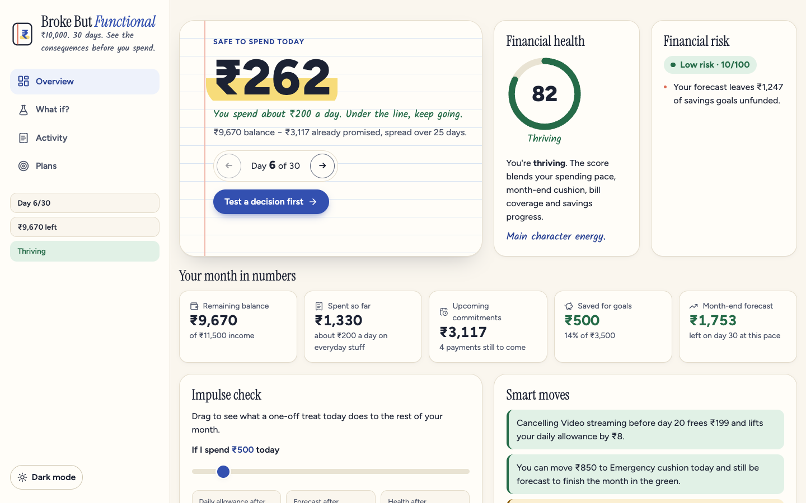
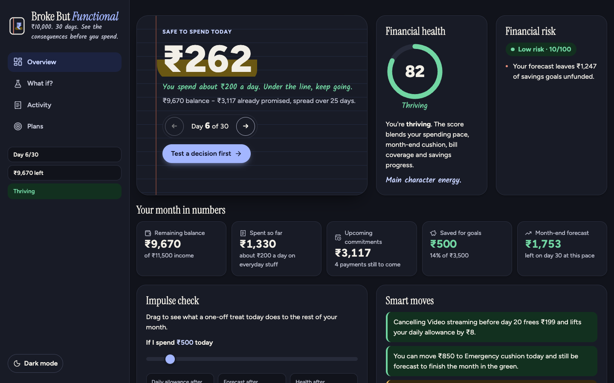
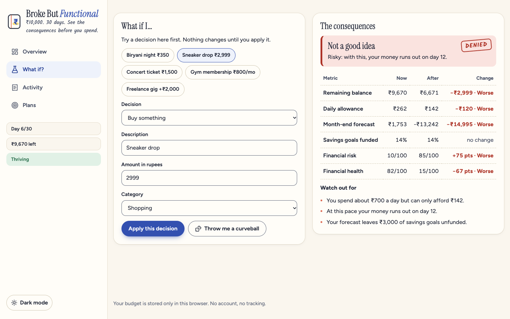
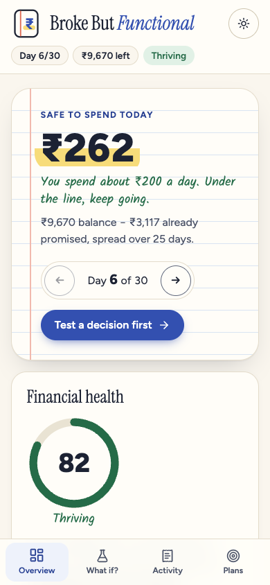
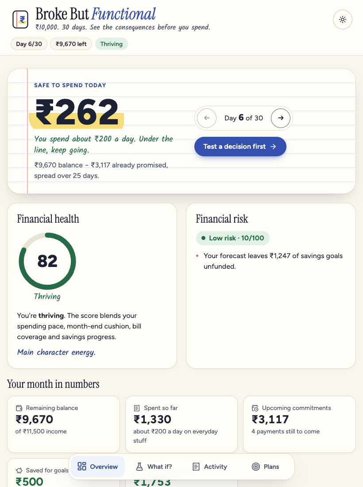
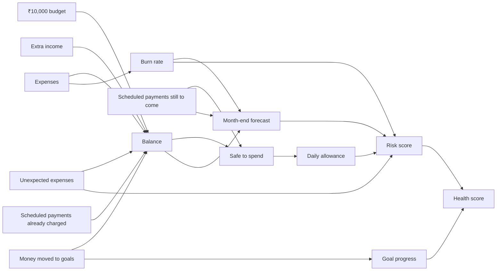

# Broke But Functional

**₹10,000. 30 days. See the consequences before you spend.**

[](https://broke-but-functional-vert.vercel.app/)


A personal finance experience for Gen Z that goes beyond expense tracking. Income, balance, spending, commitments, subscriptions, savings goals, unexpected expenses, risk and financial health are all derived from one ledger, so every decision visibly moves everything else. Any decision can be simulated first.

**Live demo:** <https://broke-but-functional-vert.vercel.app/>
**Repository:** <https://github.com/Sagnik120/Broke-But-Functional>



| Dark theme                                                        | What-if simulator                                                                  |
| ----------------------------------------------------------------- | ---------------------------------------------------------------------------------- |
|  |  |

| Phone (bottom tab bar)                                                   | Tablet (floating dock)                                             |
| ------------------------------------------------------------------------ | ------------------------------------------------------------------ |
|  |  |

## Table of contents

1. [Features](#features)
2. [Tech stack](#tech-stack)
3. [Getting started](#getting-started)
4. [Usage](#usage)
5. [How the numbers connect](#how-the-numbers-connect)
6. [Architecture](#architecture)
7. [Project structure](#project-structure)
8. [Responsive design](#responsive-design)
9. [Design system and motion](#design-system-and-motion)
10. [Performance](#performance)
11. [Accessibility](#accessibility)
12. [Security](#security)
13. [Testing](#testing)
14. [Scripts](#scripts)
15. [Deployment](#deployment)
16. [Environment variables](#environment-variables)
17. [Documentation](#documentation)
18. [Known limits and roadmap](#known-limits-and-roadmap)
19. [Contributing](#contributing)
20. [License](#license)

## Features

| Problem statement                                                 | Where it lives                                                                                                                              |
| ----------------------------------------------------------------- | ------------------------------------------------------------------------------------------------------------------------------------------- |
| Manage a limited ₹10,000 budget over 30 days                      | **Overview**: balance, "safe to spend today", a day stepper that moves the calendar                                                         |
| Income, spending, unexpected expenses                             | **Activity**: log expenses, income and one-off shocks; spending by category                                                                 |
| Commitments and subscriptions                                     | **Plans**: scheduled payments are reserved before the allowance is calculated and charged on their due day; subscriptions cancel and resume |
| Savings goals                                                     | **Plans**: money moved to a goal leaves the spendable balance; removing a goal returns it                                                   |
| Simulate decisions before taking them                             | **What if?**: six decision types, one-tap scenario presets, nothing changes until "Apply"                                                   |
| Effect on balance, daily allowance, goals, forecast, risk, health | The impact table shows all six before and after, with a verdict: Go for it / Think twice / Not a good idea                                  |
| Monthly forecast                                                  | Actual vs projected balance chart, the day money runs out, and a 30-day **month map** heatmap                                               |
| Financial risk and health                                         | 0–100 risk score with plain-language reasons; 0–100 health gauge with a grade                                                               |
| Unexpected expenses                                               | "Throw me a curveball" draws a surprise expense into the simulator                                                                          |
| Visible, interconnected consequences                              | **Impulse check** slider recalculates the month as you drag; **Smart moves** quotes simulator-backed numbers                                |

Beyond the brief:

- **Impulse check**: drag a slider to see what a one-off treat does to your allowance, forecast and health, live.
- **Month map**: a calendar heatmap of the 30 days, with bills dotted and any shortfall flagged.
- **Achievements**: six badges earned from real behaviour, such as an on-pace streak or cancelling a subscription before it bills.
- **Light and dark themes** that follow the system and remember your choice.
- **Works offline** and is installable: a service worker caches the app shell.
- **Deep links**: every view has its own URL and the back button works.

## Tech stack

| Layer      | Choice                                                                          |
| ---------- | ------------------------------------------------------------------------------- |
| Framework  | React 19, TypeScript 6 (strict)                                                 |
| Build      | Vite 8 (Rolldown) with `manualChunks` vendor splitting                          |
| Styling    | Tailwind CSS 4 for layout and responsive utilities; a token-based design system |
| Icons      | Lucide                                                                          |
| State      | React Context + `useReducer`; all figures derived by pure functions             |
| Monitoring | `web-vitals` (LCP, INP, CLS, FCP, TTFB), loaded after first paint               |
| Offline    | Hand-written service worker, no plugin                                          |
| Testing    | Vitest, Testing Library, user-event, axe-core                                   |
| Quality    | ESLint (typescript-eslint, react-hooks, jsx-a11y), Prettier, EditorConfig, CI   |

There is no backend, database or third-party request. Fonts are self-hosted.

## Getting started

### Prerequisites

- Node.js 20 or newer
- npm 10 or newer

### Installation

```bash
git clone https://github.com/Sagnik120/Broke-But-Functional.git
cd Broke-But-Functional
npm install
```

### Run

```bash
npm run dev        # development server at http://localhost:5173
npm run check      # typecheck + lint + format check + tests + production build
npm run preview    # serve the production build at http://localhost:4173
```

## Usage

1. The app opens on a demo month (day 6, sample data) so the dashboard is alive. **Start a fresh month** on the Overview resets to a clean ₹10,000.
2. Use the arrows next to "Day 6 of 30" to move through the month. Bills are charged as their day arrives.
3. Drag the **Impulse check** slider, or open **What if?**, to test a decision. Read the verdict and the before/after table, then choose **Apply this decision** or walk away.
4. Log real spending and income in **Activity**.
5. Add savings goals, subscriptions and commitments in **Plans**.

A fuller walkthrough is in [docs/USER_GUIDE.md](docs/USER_GUIDE.md).

## How the numbers connect



- **Balance** = ₹10,000 + extra income − expenses − money moved to goals − scheduled payments already charged
- **Safe to spend** = balance − scheduled payments still to come
- **Daily allowance** = safe to spend ÷ days left (including today)
- **Burn rate** = everyday spending ÷ days elapsed. Unexpected expenses are excluded so one shock does not distort the pace
- **Forecast** = today's balance, minus the burn rate each remaining day, minus each scheduled payment on its due day
- **Risk (0–100)** = spending pace vs allowance (up to 35) + running out or a thin month-end cushion (up to 40) + balance not covering promised payments (20) + unfunded goals (10) + shock exposure (up to 5)
- **Health (0–100)** = 90% from low risk + 10% from savings-goal progress

## Architecture


The numbered arrows follow one user action end to end. Solid arrows are real state changes; dashed arrows are the simulator working on a copy. The diagram was drawn before the folders were renamed: its "State (`src/state`)" band is now `src/context` and `src/hooks`, and its "Domain (`src/domain`)" band is now `src/engine`, `src/utils` and `src/services`. The structure is otherwise unchanged.

Three rules keep it clean:

1. **One source of truth.** `FinanceState` is the only stored data. Everything on screen is derived from it by `computeSnapshot`, so views cannot disagree.
2. **The engine is pure.** `src/engine/` has no React and no DOM. Clocks and randomness are injected. It is tested without rendering anything.
3. **The simulator reuses the real reducer.** A preview runs the same action on a copy of the state, so it can never differ from what applying the decision does.

Layers, data flow and decisions: [ARCHITECTURE.md](ARCHITECTURE.md).

## Project structure

```
.
├── public/               Static files: service worker, manifest, favicon, robots, security headers
├── src/
│   ├── assets/           Illustrations
│   ├── components/
│   │   ├── charts/       ForecastChart, HealthGauge, MonthMap
│   │   ├── common/       ErrorBoundary
│   │   ├── dashboard/    HeroCard, StatsGrid, QuickCheck, SmartMoves, Achievements, …
│   │   ├── layout/       AppShell, PrimaryNav, ThemeToggle, MonthStatus, SkipLink, OfflineNotice
│   │   ├── plans/        GoalsPanel, ScheduledPanel
│   │   ├── simulator/    ImpactTable, draft (form → decision)
│   │   └── ui/           Field, Tabs, Badge, ProgressBar, ConfirmButton, AnimatedNumber, EmptyState, …
│   ├── constants/        Limits, labels, routes, scenario presets
│   ├── context/          FinanceProvider, ThemeProvider and their contexts
│   ├── engine/           Pure finance logic: ledger, reducer, simulate, insights, monthMap, achievements
│   ├── hooks/            useFinance, useTheme, useHashRoute, useMediaQuery, useAnimatedNumber, …
│   ├── pages/            DashboardPage, SimulatorPage, ActivityPage, PlansPage (route-level, lazy-loaded)
│   ├── services/         storage, preferences, webVitals, serviceWorker
│   ├── styles/           tokens, base, components, shell, widgets, motion
│   ├── test/             Test setup and helpers
│   ├── types/            Domain and UI types
│   ├── utils/            format, sanitize, rateLimit, id, cn
│   ├── App.tsx           Providers, routing and code splitting
│   └── main.tsx          Entry point
├── docs/                 SRS, accessibility, design system, user guide, screenshots
├── ARCHITECTURE.md  TESTING.md  SECURITY.md  CONTRIBUTING.md  CHANGELOG.md  CODE_OF_CONDUCT.md  LICENSE
└── vite.config.ts  tsconfig.json  eslint.config.js  .prettierrc  .editorconfig  vercel.json
```

Imports use the `@/` alias for `src/`.

## Responsive design

One DOM, three layouts. The navigation is a single element that CSS repositions; it is never duplicated.

| Width     | Layout                                                                |
| --------- | --------------------------------------------------------------------- |
| < 768 px  | Top bar, single-column cards, fixed bottom tab bar within thumb reach |
| ≥ 768 px  | Six-column bento grid, floating dock                                  |
| ≥ 1024 px | Sticky sidebar with vertical navigation                               |
| ≥ 1280 px | Twelve-column bento grid                                              |
| ≥ 1536 px | Wider content column                                                  |

- Mobile-first `min-width` media queries at 480, 640, 768, 1024, 1280 and 1536 px, plus Tailwind `sm:` `md:` `lg:` `xl:` utilities in the markup.
- Container queries let the impulse check and month map adapt to their own width, not the viewport.
- Fluid type with `clamp()`, relative units throughout, `100dvh` with a fallback, and safe-area insets for notched phones.
- Also handled: landscape phones, coarse pointers (larger targets), hover-capable devices, `prefers-contrast`, print.
- Checked in a headless browser at 320, 390, 820 and 1440 px with no horizontal overflow.

## Design system and motion

**Pocket Ledger**: a paper-notebook look. Cream pages (or a "night ledger" in dark mode), navy ink, one ballpoint-blue accent, a marigold highlighter, a coral margin line, ruled and dot-grid textures. Instrument Serif for headings, Figtree for UI and figures, Kalam for handwritten notes.

Every colour, radius, shadow, easing, duration and font is a CSS custom property in `src/styles/tokens.css`, exposed to Tailwind through `@theme`. Details: [docs/DESIGN_SYSTEM.md](docs/DESIGN_SYSTEM.md).

| Animation                            | What it explains                                     |
| ------------------------------------ | ---------------------------------------------------- |
| Loader that writes a ledger page     | The app is opening                                   |
| Skeleton shimmer                     | A view is on its way                                 |
| Count-up on amounts (300 ms)         | A figure travelled from its old value to its new one |
| Highlighter sweep                    | Which number matters most today                      |
| Balance line draws to "you are here" | Past is fact; the dashed part is forecast            |
| Health ring fill and colour change   | The score being measured, and its grade              |
| Verdict stamp                        | The simulator has ruled on a decision                |
| Day number flip                      | The calendar turned                                  |
| Pulsing risk dot                     | High risk needs attention                            |
| Badge pop, card stagger, list entry  | Something was earned or just arrived                 |
| Field error nudge                    | That input was rejected                              |

All motion stops under `prefers-reduced-motion`.

## Performance

Measured with Lighthouse (mobile emulation, simulated throttling) against `npm run preview`, which serves uncompressed files:

| Metric                   | Result |
| ------------------------ | ------ |
| Performance score        | 96     |
| Largest Contentful Paint | 2.7 s  |
| First Contentful Paint   | 1.4 s  |
| Total Blocking Time      | 10 ms  |
| Cumulative Layout Shift  | 0.003  |

- **Code splitting:** the dashboard ships first; Simulator, Activity and Plans are lazy route chunks behind `Suspense`, prefetched when the browser is idle.
- **Vendor chunking:** `manualChunks` separates React, icons and `web-vitals` from app code, so a deploy only invalidates what changed. About 88 kB of gzipped JavaScript on first load.
- **Rendering:** the snapshot is memoised on state; charts are `memo`ised; the impulse slider and simulator preview use `useDeferredValue` so input never waits for maths.
- **Loading:** a static shell in `index.html` paints before JavaScript runs; the UI font is preloaded; images are lazy-loaded with explicit dimensions.
- **Caching:** hashed assets are immutable for a year; the service worker serves them cache-first and pages network-first.
- **No layout shift:** animations use transform, opacity and paint-only properties.
- **Field data:** `web-vitals` records LCP, INP, CLS, FCP and TTFB in the user's browser and dispatches them as `bbf:web-vital` events.

## Accessibility

- Lighthouse accessibility 100; axe-core runs against every view, in both themes, in the test suite.
- Skip link, `banner`, `navigation`, `main` and `contentinfo` landmarks, one `h1`, ordered headings.
- WAI-ARIA tabs with roving tabindex (arrow keys, Home, End), `aria-orientation` that follows the layout, and a focusable tab panel.
- Every input has a visible label; errors are linked with `aria-describedby` and `aria-invalid`.
- The slider reports its meaning through `aria-valuetext`; the month map has a sentence per day for screen readers.
- Changes are announced through a polite live region; blocked actions through an alert.
- Status never relies on colour alone; 44 px targets; visible focus rings; forced-colours and high-contrast support.

Details: [docs/ACCESSIBILITY.md](docs/ACCESSIBILITY.md).

## Security

- Free text is normalised and stripped of markup delimiters, control, zero-width and bidi-override characters, then length-capped.
- Amounts and days are parsed with strict whole-number patterns and ranges.
- Stored data is untrusted: re-validated field by field, rebuilt into fresh objects, oversized payloads refused.
- A sliding-window rate limiter guards every state change; every collection is size-capped.
- Strict Content Security Policy with no `unsafe-inline` and no `unsafe-eval`, plus `X-Frame-Options`, HSTS and `nosniff`.
- No `dangerouslySetInnerHTML`, no `eval`, no third-party requests.

Threat model, including why SQL injection and server-side DDoS protection do not apply to a static app: [SECURITY.md](SECURITY.md).

## Testing

220 tests in 18 files, 99% statement coverage, with thresholds enforced in `vite.config.ts`.

```bash
npm test                 # run once
npm run test:coverage    # with a coverage report
```

Covers the finance engine, reducer, simulator, insights, month map, achievements, sanitiser, storage, rate limiter, services, every hook and UI primitive, and each view through real user interactions, including keyboard navigation, hostile input, corrupt storage, deep links, themes and automated accessibility checks. Strategy: [TESTING.md](TESTING.md).

## Scripts

| Command                 | What it does                                   |
| ----------------------- | ---------------------------------------------- |
| `npm run dev`           | Development server with hot reload             |
| `npm run build`         | Typecheck, then production build into `dist/`  |
| `npm run preview`       | Serve the production build                     |
| `npm test`              | Run all tests once                             |
| `npm run test:watch`    | Tests in watch mode                            |
| `npm run test:coverage` | Tests with coverage and thresholds             |
| `npm run lint`          | ESLint                                         |
| `npm run format`        | Format everything with Prettier                |
| `npm run format:check`  | Verify formatting                              |
| `npm run typecheck`     | TypeScript only                                |
| `npm run check`         | Typecheck, lint, format check, tests and build |

## Deployment

The app is static. `npm run build` writes `dist/`, which any static host can serve.

- **Vercel:** import the repository; the build command is `npm run build` and the output directory is `dist`. `vercel.json` adds the security and caching headers.
- **Netlify or Cloudflare Pages:** same build settings; `public/_headers` supplies the headers.
- **Anywhere else:** upload `dist/`. Routing uses the URL hash, so no rewrite rules are needed.

## Environment variables

None. The app has no API, keys or secrets. See [.env.example](.env.example).

## Documentation

| Document                                                                   | Contents                                                        |
| -------------------------------------------------------------------------- | --------------------------------------------------------------- |
| [ARCHITECTURE.md](ARCHITECTURE.md)                                         | Layers, data model, data flow, key decisions                    |
| [TESTING.md](TESTING.md)                                                   | Test strategy and coverage                                      |
| [SECURITY.md](SECURITY.md)                                                 | Threat model and controls                                       |
| [CONTRIBUTING.md](CONTRIBUTING.md)                                         | Setup, conventions and the pull-request checklist               |
| [CHANGELOG.md](CHANGELOG.md)                                               | Release history                                                 |
| [CODE_OF_CONDUCT.md](CODE_OF_CONDUCT.md)                                   | Community standards                                             |
| [docs/SRS.md](docs/SRS.md)                                                 | Requirements specification with a traceability matrix           |
| [docs/DESIGN_SYSTEM.md](docs/DESIGN_SYSTEM.md)                             | Tokens, breakpoints, components and motion                      |
| [docs/ACCESSIBILITY.md](docs/ACCESSIBILITY.md)                             | Accessibility conformance notes                                 |
| [docs/USER_GUIDE.md](docs/USER_GUIDE.md)                                   | How to use each view                                            |
| [docs/ARCHITECTURE_DIAGRAM_PROMPT.md](docs/ARCHITECTURE_DIAGRAM_PROMPT.md) | A ready-to-paste prompt for generating the architecture diagram |

## Known limits and roadmap

- One month, one user, one device: there is no sync or multi-month history.
- Whole rupees only.
- The calendar is advanced manually so the forecast can be explored; it is not tied to the real date.
- An everyday purchase in the simulator raises the projected pace for the rest of the month, so large one-offs are better modelled as "Unexpected expense".
- Lighthouse was run locally against an uncompressed preview server, where LCP is slightly over the 2.5 s target; hosted, compressed numbers have not been measured.

Next: month-to-month history, data export and import, recurring income, and undo for destructive actions.

## Contributing

Issues and pull requests are welcome. Start with [CONTRIBUTING.md](CONTRIBUTING.md) and the [Code of Conduct](CODE_OF_CONDUCT.md).

## License

[MIT](LICENSE)
