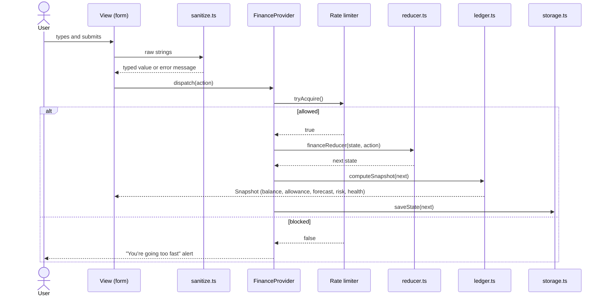
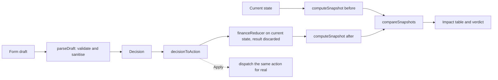

# Architecture


## Layers

| Layer | Folder | May import from | Responsibility |
| --- | --- | --- | --- |
| Domain | `src/domain/` | Nothing outside itself | Data model, state transitions, every calculation, validation, persistence format |
| State | `src/state/` | Domain | Holds the ledger in a reducer, memoises the snapshot, rate-limits changes, persists, announces |
| Hooks | `src/hooks/` | React only | Reusable behaviour (animated numbers) |
| Views | `src/components/<view>/` | Domain, state, hooks, ui | One folder per screen; turns form input into validated actions |
| Primitives | `src/components/ui/` | Domain formatting, hooks | Small accessible building blocks with no knowledge of finance state |
| Styles | `src/styles/` | — | Tokens, base, components, motion |

Dependencies point inward only. The domain layer does not know React exists.

## Data model

```ts
FinanceState {
  version: 1
  currentDay: number              // 1–30
  transactions: Transaction[]     // expense | income | saving
  scheduled: ScheduledPayment[]   // commitment | subscription
  goals: Goal[]
}
```

Deliberately not stored: balance, allowance, forecast, risk, health, goal totals. They are derived on demand by `computeSnapshot(state)`, so they cannot go stale.

Goal contributions are `saving` transactions that reference a goal. This gives one ledger for the activity feed, the balance and goal progress.

## Data flow



## Simulation



The preview and the real change share `decisionToAction` and `financeReducer`. A test asserts that applying a decision produces the simulated balance.

## Key decisions

| Decision | Reason | Trade-off |
| --- | --- | --- |
| No backend | The problem is a single-user simulation; a server adds attack surface and latency for no user benefit | No sync between devices |
| `useReducer` + context instead of a state library | One small state object, one consumer tree | Every consumer re-renders on change; acceptable at this size and mitigated by `memo` on the chart and gauge |
| Derived snapshot instead of stored totals | Removes a whole class of inconsistency bugs | Recomputed on each change (about 30 × n operations, negligible) |
| Hand-written SVG chart | Avoids a chart library many times the size of the app | Fewer chart features |
| CSS animations plus one small hook instead of an animation library | Keeps first-load JavaScript near 79 kB and CSP strict | No physics-based springs |
| Whole rupees | Avoids floating-point money errors; matches how small UPI amounts are used | No paise |
| Scheduled payments charged by derivation (`dueDay <= currentDay`) | The calendar can be moved without replaying events | Cancelling stores a day rather than an event log |
| Unexpected expenses excluded from burn rate | One shock should not make every remaining day look worse | The forecast assumes no further shocks |
| Clock and randomness injected | Deterministic tests | Slightly more parameters |

## Error handling

- **Invalid input:** rejected by `sanitize.ts` with a message shown next to the field.
- **Invalid actions:** the reducer returns the same state (for example saving to a missing goal).
- **Corrupt storage:** `parseState` drops bad entries or returns `null`, and the app falls back to the demo month.
- **Storage unavailable:** `saveState` returns `false`; the app keeps working in memory.
- **Rendering fault:** `ErrorBoundary` shows a reload prompt.

## Build and delivery

Vite produces hashed static assets. Two build-only plugins in `vite.config.ts` add the Content Security Policy meta tag and a preload for the UI font. `vercel.json` and `public/_headers` supply HTTP security headers and long-lived caching for hashed assets.
